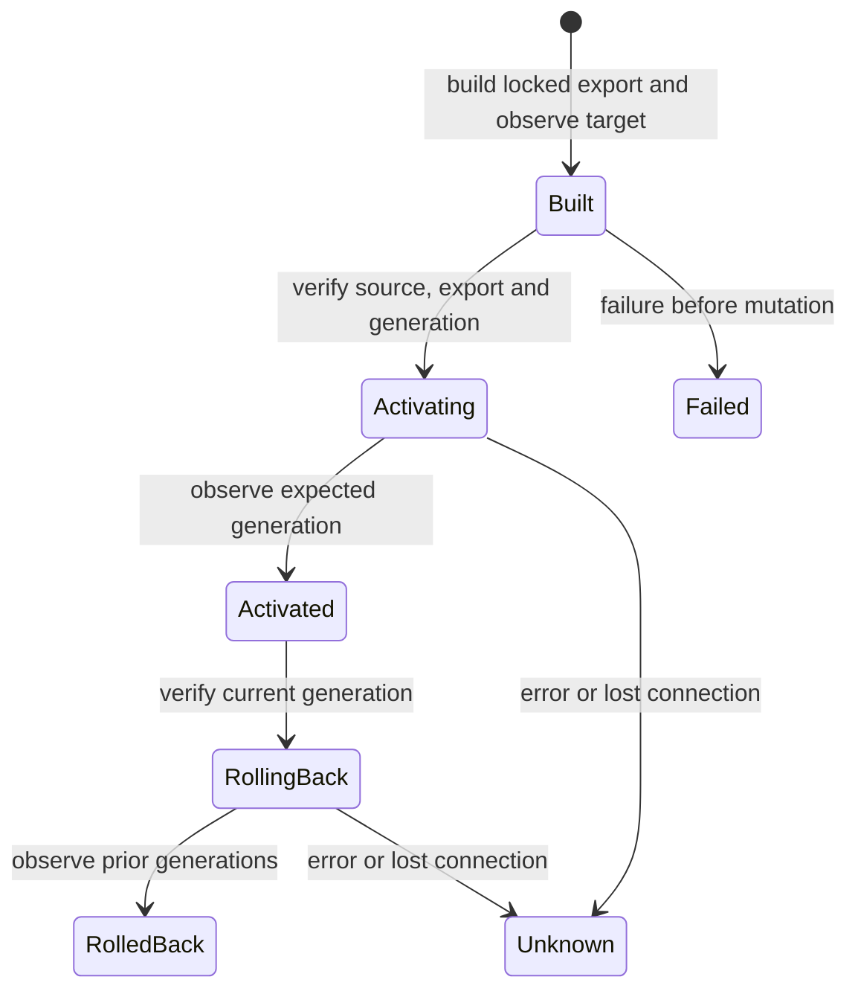

# Stringbed architecture

## Scope of this development pass

Implement roadmap steps 1–5 before the first user-led EmptyNet reconstruction.
The user will recreate shared modules and a machine with Stringbed as the first
joint verification pass. Automated verification uses generic isolated consumers;
no live fleet activation, migration or deletion is part of this development pass.

The product is a programmable environment for authoring and operating Nix
configuration. Its default vocabulary is extensible Racket, not a closed schema
for everything users may express. Nix retains package/module/evaluation/build
semantics; interfaces edit source intent and reveal generated and evaluated views.

## Decisions and alternatives

| Decision | Reason | Alternative rejected or deferred |
|---|---|---|
| Data workspace + trusted executable extensions | Preserve predictable structured edits while permitting arbitrary Racket generators | Making every workspace execute arbitrary code on inspection |
| Content-addressed local extension snapshots | Capture the complete declared bundle, including helper code, and verify before loading | Pinning only the entry file, which misses dependency changes |
| Fresh extension namespaces with shared API identities | Reload code without mixing old definitions into new registries | Mutable global plugin registration |
| Persistent journal keyed by workspace content | Restore undo across sessions and recognize concurrent changes | A GUI-only ephemeral history |
| Explicit NixOS and Home Manager scopes | Their option namespaces and activation lifecycles differ | Pretending all modules share one universal option namespace |
| Native Nix evaluation for winning values and origins | Respect Nix types, merge priorities, conditions and module imports | Implementing a competing Racket module evaluator |
| Common command model plus UI plugins | Every interface can edit the same intent; domain editors live with extensions | A central switch per GUI/TUI feature |
| Immutable deployment plans and state journals | Bind execution to a reviewed build and expected current generation | Re-evaluating mutable source at activation time |
| Independent fleet-library package | Package producers must remain usable without the fleet or editor | Moving agent runtime implementations into Stringbed itself |

## Authority and dependency direction

Machine workspaces own selections, identities, paths, topology, encrypted secret
references and notes. The fleet library owns reusable opt-in capabilities. Package
repositories own reusable software and generic integration. Stringbed owns editing,
provenance and lifecycle tooling. The tool must not require a user's fleet.

Generated Nix, option indexes, previews and manifests are projections. Authored
workspace data, extension bundles and Nix locks are the reproducibility inputs.
A generated node is edited through its authored parameters or generator source;
no interface claims to invert arbitrary Racket computation.

## Component contracts

This document is updated with verified implementation details as the components
are integrated. Each component's failure modes, state transitions and evidence
must be recorded here before the pass is described as complete.

### Data, source and durability

`model.rkt` owns schema validation, stable node IDs, annotations, sessions and
atomic persistence. Schema 2 adds authored/generator provenance; schema 1 stays
readable until explicit migration creates an exact `.v1.bak`. The reader accepts
one data object and disables executable reader extensions and cyclic graphs.
Unknown form kinds can still be inspected as data; expansion fails explicitly.

A session holds a semantic draft, undo history and the exact source/journal
baseline it opened. Saving takes a cooperating-writer directory lock, compares
both baselines, stores exact old bytes in `.stringbed/sources/<sha256>`, writes
history for the new content hash, then atomically replaces source. Reopening
selects history by the source digest. This ordering avoids a crash leaving a new
source with only old history. Noncooperating external writers remain outside the
lock protocol; atomic replacement is not a distributed database transaction.

Notes and documentation URLs are model fields and survive all interfaces.
Arbitrary Racket comments/layout are **not span-preserved** on canonical save;
exact old source remains recoverable by digest. This is a deliberate remaining
part of the original document-preservation milestone, not a claim that a
pretty-printer is a lossless editor. Moving a workspace with its `.stringbed`
directory preserves history and snapshots; renaming a file requires moving its
per-filename lock/history association. Do not infer identity from a display name.

`dsl.rkt` is an ordinary Racket library of replaceable constructors. Generators
materialize a workspace and record their entry path and hash. That provenance is
navigation/audit information, not proof of hermetic execution: arbitrary Racket
may read other files, environment variables or the network. Editing a materialized
node does not rewrite its generator. A future source-span editor should extend
this contract rather than inventing a reversible mapping for arbitrary code.

### Extension identity and reload

`extension.rkt` is the shared runtime API: field/form descriptors and typed Nix
assignment/import/expression/path values. Sharing its module instance matters:
Racket struct predicates from independent namespaces otherwise reject each
other's values. `durability.rkt` loads fresh extension namespaces with that API
attached. The UI plugin loader likewise shares its canonical API/session types.

`pin` snapshots the entire explicitly selected directory, including helper code
and resources. A deterministic file manifest produces its SHA-256 identity;
symlinks and traversal entries are refused. The workspace lock records entry
point, manifest, Racket version and API digest. Every locked load verifies the
snapshot; source changes require an explicit repin. It does not silently fetch
missing code or downgrade a lock. The folder should be a portable bundle, not an
entire development checkout with build artifacts.

These are integrity/reproducibility controls, not a sandbox or signature system.
Code can deliberately import outside its bundle. Opening an editor executes its
trusted pinned forms; explicit development extensions/plugins also execute code.
`show FILE` is the non-executing inspection path. Distribution, signatures and
full dependency closure pinning remain separate work. Live reload constructs a
new registry/plugin pair before replacing the active pair; failure preserves the
old editor state. Extensions cannot silently replace reserved core commands.

### Compilation and the Nix boundary

`compiler.rkt` validates forms, expands each node once per export, and emits both
Nix and authored provenance from that same expansion snapshot. Stable `_file`
labels identify `stringbed:WORKSPACE/NODE` in Nix's own definition diagnostics.
Values escape strings/interpolation and quote attribute paths. Raw Nix expressions
and paths are explicit trusted extension capabilities; ordinary option data can
contain nested lists and attribute sets.

NixOS nodes default to `system`; standalone Home Manager nodes default to `home`.
Integrated NixOS homes use `home:USER` and explicit home metadata. Home-scoped
expansion receives a Home Manager context, so a package becomes `home.packages`
without accidentally writing system packages. This is scope adaptation, not a
second module merge implementation. Each generated module uses native Nix
imports, conditions, priorities, types and assertions.

An export contains `configuration.nix`, `flake.nix`, optional `homes/USER.nix`,
`provenance.json` and `target.json`. The target manifest includes platform, adapter,
homes and the canonical workspace digest. Export destinations must be new;
optional lock reuse copies the prior Nix lock. Exported flakes require no Stringbed
runtime. Keeping machine intent local does not mean losing its recovery copy:
back up the workspace, `.stringbed`, exported lock and tool revision together.

`nix-query.rkt` queries the locked exported flake, never an ambient channel.
Exact package attribute lookup avoids evaluating all of nixpkgs; nonexact/regex
search uses Nix's package search and can be resource-heavy. Option discovery
projects descriptions, types, defaults and declaration locations. Evaluated why
uses Nix's effective configuration and definition locations. Function/deep values
are marked unavailable; module evaluation conflicts remain errors.

Integrated home schema metadata does not expose full evaluated definition origins.
Its effective values come from the containing NixOS evaluation; results explicitly
set `definitionsComplete = false`. Even complete `definitionsWithLocations` is
not a causal graph of every conditional dependency. Authored why and evaluated why
are separate views for this reason. No hand-maintained option catalogue competes
with the pinned input's API.

### Interfaces and programmatic commands

`session.rkt` is the editing command boundary. Each edit computes a candidate,
validates/expands it, and commits only on success. Stable IDs connect parameters,
notes, docs, source and provenance. `main.rkt` exposes those commands to scripts;
only actual CLI changes trigger automatic save, even with persistent undo history.

`gui.rkt` provides descriptor-generated fields, filtering, source editing,
structured diff, Nix/why previews and custom editors. `tui.rkt` provides a
full-screen ANSI editor on a terminal, restoring terminal state on exit, and a
line/menu fallback for pipes. Both support trusted plugin commands/editors and
reload. Removal is a desired-configuration edit with confirmation/diff and undo;
it does not uninstall software from the current machine. Nix activation decides
what changes on the running system.

`ui-extension.rkt` defines command and editor hooks. A GUI editor receives parent,
session, registry, node ID and execution callback; a TUI editor receives those
model objects plus prompt/execute callbacks. Plugin command handlers receive
session, registry and arguments. Plugins can reprogram interactions without
modifying a central core dispatch branch. Trusted plugins can bypass contracts
if deliberately written to do so; this extensibility is not an untrusted addon API.

### Operations and lifecycle

`operations.rkt` owns argv process execution, bounded output/time, SSH target
validation and shell quoting. Remote commands require a shell, so each word is
quoted independently. SSH uses batch mode and normal host-key verification.
Process failure output is withheld from exceptions because it may contain secrets.
The runner is injectable for deterministic failure tests; this is not a replacement
for real SSH and booted-machine integration tests.

`lifecycle.rkt` separates immutable intent from mutable observations:

A plan binds exact source bytes, the entire locked export, canonical authored
model identity, target/profile, adapter, built closure and prior selected/active
generations. Wrong adapter/source combinations fail before build. Builds select
`packages.<target-system>.default` explicitly, so a remote builder need not match
the editor's platform. A `PLAN.result` GC root retains the new closure. Plans are
read-only JSON with a content digest; the digest detects accidental edits, not
malicious forgery or authorization. `PLAN.journal.json` records state transitions.

Apply revalidates fingerprints, takes operation/target locks, checks generation
preconditions, copies the closure if remote, rechecks, verifies its activation
entry, selects the profile, activates, and verifies observed state. The build
host and activation host are independent. NixOS uses noninteractive sudo plus
`switch-to-configuration`; Home Manager requires an explicit profile and its
versioned activation driver. Forward and rollback generations must expose
`gen-version >= 1`; unsupported old generations fail before profile mutation.
Existing profiles are required: initial installation
onto a bare machine is not an activation adapter. Lifecycle currently accepts
Linux targets; Darwin execution remains a separate adapter validation gate. Stringbed does not guess a user's profile location.

Rollback is permitted from verified activation and restores the prior active and
selected generations. It does not require the original source to remain available.
After a disconnect or partial switch, state is unknown: inspect/reconcile before a
fresh plan. This conservative rule avoids calling a failed command a successful
rollback. Target-side locks serialize cooperating Stringbed operations across
plans/callers; unrelated nixos-rebuild/home-manager commands do not honor them.
Owned locks are released after known pre-mutation failures. An uncertain activation
or acquisition/release retains a lock; inspect the target and any still-running
process before removing it. There is no automatic claim that uncertainty means the remote process stopped.

`encrypted-secret-metadata` hashes an apparently encrypted SOPS document without
decrypting it. It is a format heuristic, not proof that every field is encrypted.
The fleet's sops adapters refer to encrypted inputs/runtime key paths. User source
can still contain an accidental secret; Stringbed cannot guarantee secrecy for
arbitrary notes, extension output or literal Nix values. Secret decryption and
recipient enrollment remain upstream/runtime concerns.

### Fleet library and migration boundary

`packages/fleet-library` is independently consumable and ready to extract into its
own repository. Its inputs are nixpkgs, Home Manager and sops-nix; no Nix code
imports Stringbed, EmptyNet or agentic-stack. `fleet.*` features are opt-in and
machine accounts/endpoints are explicit consumer inputs. The developer composition
is a small ordinary module that consumers can override with Nix priorities.

Generic SSH, containers, shell/development, remote desktop, EXWM session,
package-service and secret capabilities reproduce reusable *interfaces*, not a
copy of an existing machine. The service adapter consumes producer packages;
complex applications should publish their own Nix module. It does not absorb the
event bus, agent runtime or credential broker into the editor. The capability
ledger assigns every reviewed EmptyNet area to tool, library, producer, machine
policy or retained procedure, including areas not reimplemented in this pass.

The next user-led pass is to recreate actual modules and one machine, evaluate
parity and test everyday editing. It may change this example DSL. Full fleet
shadowing, activation and retirement follow the gates in `docs/roadmap.md`.
No existing host's source or running configuration is changed by these fixtures.

## Verification and remaining gates

`docs/validation.md` records executed tests separately from aspirational exit
criteria. Unit/process tests cover persistence, corruption/concurrency, scope
adaptation, extensions, command atomicity and lifecycle failures. Real Nix checks
exercise integrated scopes and the independent generic fleet consumer. GUI, PTY
and disposable SSH checks exercise actual platform boundaries.

Remaining release gates include source-span-preserving edits, complete extension
closure/trust distribution, Darwin execution, booted NixOS/Home Manager deployment
rehearsal and actual EmptyNet parity. The components through step 5 are implemented;
these original roadmap acceptance criteria must not be marked passed by injected
runners or Linux-only evaluation. Source normalization and the integrated-home
provenance limitation are exposed behaviors to assess in the joint pass.

## Upstream references

- [Racket namespaces and module instances](https://docs.racket-lang.org/guide/mk-namespace.html)
- [Racket GUI](https://docs.racket-lang.org/gui/)
- [Nix manual](https://nix.dev/manual/nix/latest/)
- [NixOS manual: modules](https://nixos.org/manual/nixos/stable/#sec-writing-modules)
- [Home Manager manual](https://nix-community.github.io/home-manager/)
- [sops-nix](https://github.com/Mic92/sops-nix)
- [NWM](https://github.com/soymou/NWM)

These links own the external concepts. This document records Stringbed's choices,
contracts and remaining limitations rather than reproducing upstream tutorials.
